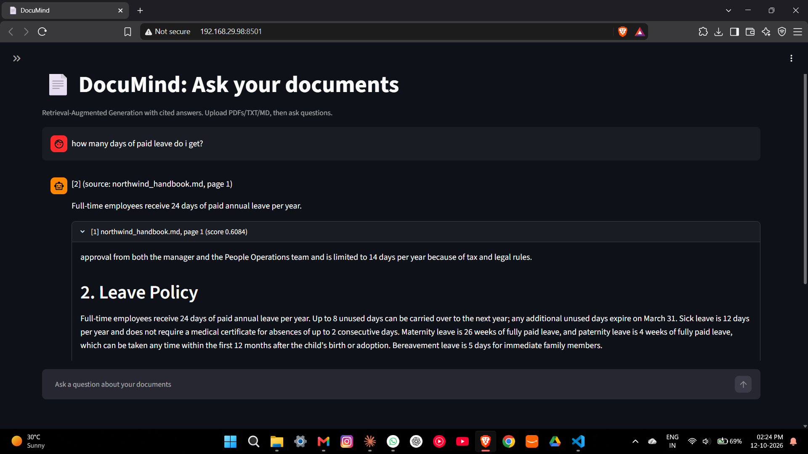

# 📄 DocuMind: RAG Document Q&A Assistant

DocuMind answers questions about **your own documents**. You upload a PDF, TXT or Markdown file,
ask a question in plain English, and get an answer **with citations** that point to the exact passages
it used. If the answer is not in your documents, it says so instead of guessing.



**Tech stack:** Python · Hugging Face sentence-transformers (embeddings) · FAISS (vector search) ·
Ollama / Llama 3.2 (free local LLM; Groq, Gemini and Anthropic also supported) · FastAPI · Streamlit ·
pytest · GitHub Actions

---

## Table of contents
1. [The problem this solves](#the-problem-this-solves)
2. [How it works](#how-it-works)
3. [Features](#features)
4. [Project structure](#project-structure)
5. [Setup and run (Windows)](#setup-and-run-windows)
6. [Choosing an LLM](#choosing-an-llm)
7. [Using the app](#using-the-app)
8. [API reference](#api-reference)
9. [Configuration](#configuration)
10. [Evaluation](#evaluation)
11. [Tests](#tests)
12. [Troubleshooting](#troubleshooting)
13. [Limitations and future work](#limitations-and-future-work)
14. [Author](#author)

---

## The problem this solves

A large language model (LLM) does not know what is inside your private documents, such as a company
handbook or a policy PDF. If you ask it about them, it may give a confident but **made-up** answer
(a "hallucination").

**Retrieval-Augmented Generation (RAG)** fixes this like an open-book exam:

1. **Retrieve:** search your documents and pick the few passages most relevant to the question.
2. **Generate:** give only those passages to the LLM and tell it to answer from them.

---

## How it works

### Step 1. Indexing (once per document)

| Stage | What happens | Why |
|---|---|---|
| **Load** | Text and page numbers are extracted from the file | The computer needs raw text; page numbers allow citations |
| **Chunk** | Text is cut into ~800-character pieces with 150 characters of overlap | Small pieces are easier to search; overlap stops sentences from being cut at the edges |
| **Embed** | Each chunk becomes a vector (a list of 384 numbers) using `all-MiniLM-L6-v2` | The numbers capture *meaning*, so similar ideas land close together even with different words |
| **Store** | Vectors are saved in a FAISS index and written to `data/index` | FAISS finds the nearest vectors fast, and saving avoids re-indexing |

### Step 2. Answering (every question)

| Stage | What happens | Why |
|---|---|---|
| **Embed the question** | The question is converted with the same model | Questions and chunks must share one "meaning space" |
| **Retrieve** | FAISS returns the top 4 most similar chunks with scores | Only relevant text goes to the LLM |
| **Safety check** | If the best score is below `MIN_SCORE` (0.25), the app refuses without calling the LLM | Saves time and avoids invented answers when nothing relevant exists |
| **Prompt** | The LLM gets rules, the numbered passages and the question | It must use only the passages and cite them like `[1]` |
| **Generate** | The LLM writes the answer (temperature 0, so results are repeatable) | Grounded, consistent answers |
| **Return** | The app returns the answer, sources, scores and response time | Users can verify every claim |

```
Document ─▶ load ─▶ chunk ─▶ embed ─▶ FAISS index
                                          │
Question ─▶ embed ─▶ top-4 search ◀───────┘
                          │
              score too low? ──yes──▶ "I couldn't find the answer…"
                          │ no
                          ▼
            prompt (rules + passages + question) ─▶ LLM ─▶ cited answer
```

---

## Features

- Upload **PDF, TXT and Markdown** files
- Answers with **inline citations** and expandable source passages showing similarity scores
- **Refuses** when the answer is not in the documents
- **Two layers against hallucination:** a similarity threshold, plus a prompt that says "answer only from the context"
- **Prompt-injection hygiene:** retrieved text is treated as data, not as instructions
- **Pluggable LLM:** Ollama (free, local), Groq, Gemini or Anthropic, switched with one setting
- **REST API** (FastAPI) with automatic docs, and a **chat UI** (Streamlit)
- **21 unit tests** that run offline using a fake LLM, plus a **16-question evaluation script**
- Index is saved to disk and re-ingesting a file replaces its old chunks

---

## Project structure

```
docmind/
├── src/docmind/
│   ├── config.py        # settings read from environment / .env
│   ├── loader.py        # read PDF / TXT / MD
│   ├── chunking.py      # overlapping text splitter
│   ├── embeddings.py    # sentence-transformers (+ a hashing embedder for tests)
│   ├── vector_store.py  # FAISS index, save/load, remove a source
│   ├── llm.py           # Ollama/Groq/Gemini client and Anthropic client
│   ├── rag.py           # the pipeline: ingest, retrieve, prompt, answer
│   ├── schemas.py       # request/response models
│   └── api.py           # FastAPI app
├── app/streamlit_app.py # chat UI
├── scripts/
│   ├── ingest.py        # index a folder from the command line
│   └── evaluate.py      # run the evaluation
├── eval/eval_set.json   # 16 evaluation questions
├── data/sample_docs/    # fictional sample handbook for demos
├── tests/               # pytest suite
├── docs/                # screenshots
├── .env.example         # settings template (copy to .env)
├── requirements.txt
├── Dockerfile, docker-compose.yml   # experimental, see Troubleshooting
└── .github/workflows/ci.yml         # runs tests on every push
```

---

## Setup and run (Windows)

You need **Python 3.11 or 3.12** (3.13 may also work), **VS Code** and **Git**.

```powershell
# 1. Get the code
git clone https://github.com/akshay18269/documind.git
cd documind

# 2. Create and activate a virtual environment
python -m venv .venv
.venv\Scripts\activate

# 3. Install packages (first time takes several minutes)
pip install -r requirements.txt

# 4. Create your settings file (defaults use free local Ollama)
copy .env.example .env

# 5. Check everything works
pytest -q
```

**Install Ollama (free local LLM):** download it from ollama.com/download, then:
```powershell
ollama pull llama3.2
ollama run llama3.2 "say hi"
```

**Start the app (two terminals, both inside the project folder with the venv active):**

Terminal 1, the API:
```powershell
$env:PYTHONPATH="src"
uvicorn docmind.api:app --reload
```
Terminal 2, the UI:
```powershell
streamlit run app\streamlit_app.py
```
Open **http://localhost:8501**.

On Mac or Linux: use `source .venv/bin/activate`, `cp .env.example .env` and `export PYTHONPATH=src`.

---

## Choosing an LLM

Set `LLM_PROVIDER` in `.env`:

| Provider | Cost | Setup |
|---|---|---|
| `ollama` (default) | Free, runs on your laptop | Install Ollama, then `ollama pull llama3.2` |
| `groq` or `gemini` | Free tier (limits apply) | Create a key, set `LLM_API_KEY` and `LLM_MODEL` |
| `anthropic` | Paid | Set `ANTHROPIC_API_KEY` and `LLM_MODEL` |

Model names change over time. If a default is outdated, set `LLM_MODEL` yourself.

---

## Using the app

1. Open the sidebar (the `>>` icon, top left) and upload `data/sample_docs/northwind_handbook.md`.
2. Click **Index file**. You should see "Indexed 7 chunks".
3. Try these questions:

| Question | Expected behaviour |
|---|---|
| How many days of paid leave do I get? | 24 days, with a citation |
| Can I roll over holiday days? | Up to 8 days (different wording, same meaning) |
| What is the notice period during probation? | 15 days |
| Who is the CEO? | Refuses: not in the document |

4. Open the source boxes under each answer to see the passages and scores.

---

## API reference

Interactive docs: **http://localhost:8000/docs**

| Method | Path | Description |
|---|---|---|
| GET | `/health` | Status, provider, model, index size |
| GET | `/documents` | Indexed documents and chunk counts |
| POST | `/ingest` | Upload a PDF/TXT/MD file and index it |
| POST | `/ask` | Body: `{"question": "...", "top_k": 4}`. Returns answer, sources, scores, latency |

Example:
```powershell
curl -X POST http://localhost:8000/ask -H "Content-Type: application/json" `
     -d '{"question": "What is the notice period during probation?"}'
```

---

## Configuration

All settings live in `.env` (see `.env.example`).

| Setting | Default | Meaning |
|---|---|---|
| `LLM_PROVIDER` | `ollama` | Which LLM backend to use |
| `LLM_MODEL` | `llama3.2` | Model name for that provider |
| `EMBEDDING_MODEL` | `all-MiniLM-L6-v2` | Sentence-transformer used for embeddings |
| `CHUNK_SIZE` | `800` | Characters per chunk |
| `CHUNK_OVERLAP` | `150` | Characters shared between neighbouring chunks |
| `TOP_K` | `4` | Passages retrieved per question |
| `MIN_SCORE` | `0.25` | Minimum similarity; below this the app refuses |
| `INDEX_DIR` | `data/index` | Where the FAISS index is saved |

Higher `TOP_K` or lower `MIN_SCORE` means more context but more risk of irrelevant text.
Larger chunks keep more context together but make retrieval less precise.

---

## Evaluation

`eval/eval_set.json` holds 16 questions about the sample handbook: **12 answerable** (each with the exact
evidence text and keywords the answer must contain) and **4 unanswerable** (should be refused).

```powershell
python scripts/evaluate.py                    # full run (retrieval + answers)
python scripts/evaluate.py --retrieval-only   # search only, no LLM needed
```

| Metric | Meaning |
|---|---|
| Retrieval hit@k | A retrieved chunk contains the gold evidence |
| Answer accuracy | The answer is not a refusal and contains all required keywords |
| Refusal accuracy | Unanswerable questions are correctly refused |
| Latency | Average time per question |

### Results

| LLM | Embeddings | Questions | hit@4 | Answer accuracy | Refusal accuracy | Mean latency |
|---|---|---|---|---|---|---|
| `llama3.2` (Ollama, local CPU) | all-MiniLM-L6-v2 | 16 | 1.00 | 1.00 | 1.00 | ~4.8 s |

> **Read this honestly:** the test set is small (16 questions), uses one short document, and several
> questions share wording with the text. These scores show the pipeline works end to end, **not** that
> it is robust on large or messy documents. Scoring uses keyword matching, which is only a rough proxy
> for answer quality.

---

## Tests

```powershell
pytest -q
```

21 tests cover chunking, the vector store (add, search, save/load, remove), the RAG pipeline and the
LLM client. They use a fake LLM and a simple hashing embedder, so they run in seconds with no internet,
API key or model download. GitHub Actions runs them on every push.

---

## Troubleshooting

| Problem | Fix |
|---|---|
| `Could not open requirements.txt` | You are in the wrong folder. `cd` into the folder that contains `requirements.txt` |
| `ollama is not recognized` | Install Ollama, then fully restart VS Code / the terminal |
| `Cannot reach the LLM server` | Make sure the Ollama app is running (llama icon in the system tray) |
| `Cannot reach API at localhost:8000` (in the UI) | Start the API in the other terminal, then refresh the page |
| `No module named docmind` | Run `$env:PYTHONPATH="src"` in that terminal |
| PowerShell blocks venv activation | Run `Set-ExecutionPolicy -Scope Process Bypass`, then activate again |
| First answer is slow | The local model loads into memory on the first call |
| Docker | `Dockerfile` and `docker-compose.yml` are provided but **experimental and not fully tested**. Note that a container needs a reachable LLM, so the default `ollama` setting points at the container's own localhost |

---

## Limitations and future work

- **No OCR:** scanned PDFs (photos of pages) cannot be read.
- **Small evaluation:** 16 easy questions on one document. Next: harder paraphrased and multi-part questions, and a written failure analysis.
- **Single-user, in-memory index:** a multi-user version would use a managed vector database.
- **Keyword-based scoring:** an LLM-as-judge or human review would be more reliable.
- **Small local model:** quality is lower than large hosted models.
- **Ideas:** a cross-encoder re-ranker, hybrid keyword + semantic retrieval, conversation memory,
  streaming responses, user authentication and cloud deployment.

---


